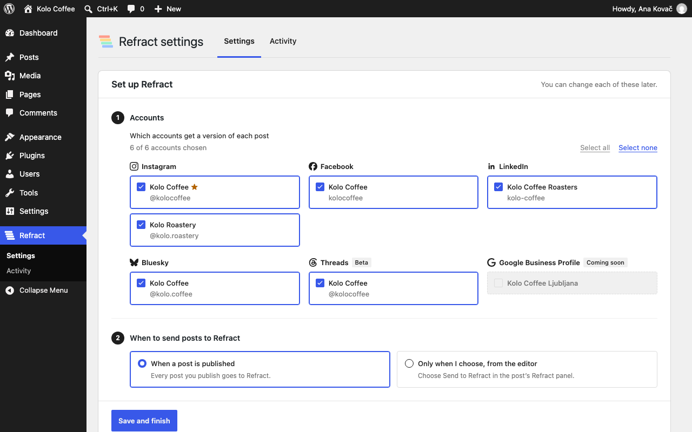
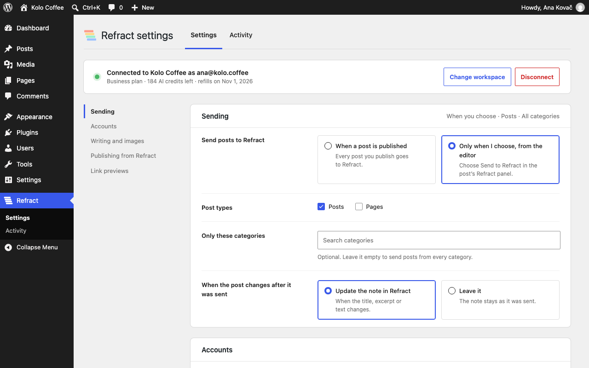
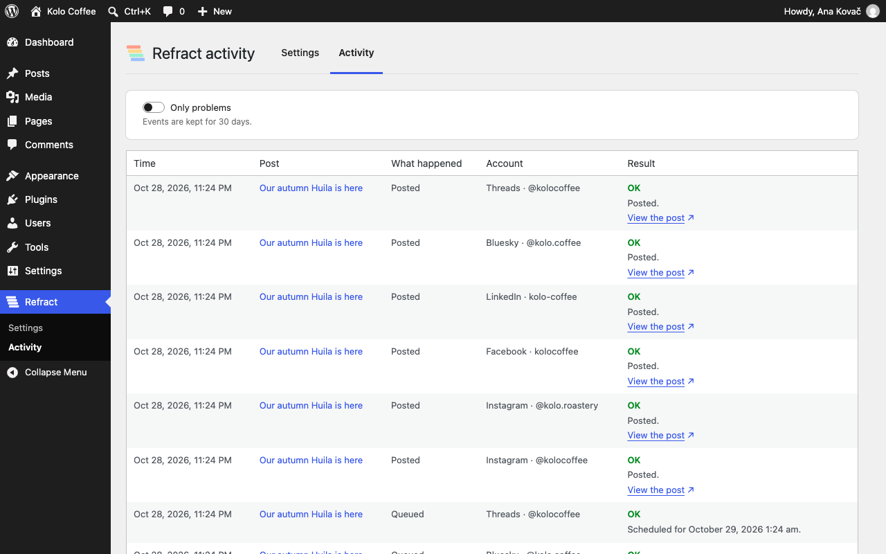

# Refract for WordPress

Refract for WordPress is a WordPress plugin that turns each blog post into a post for every social media network, in
your voice. You approve every version, then Refract schedules them. This repository holds the plugin's source code.
To use it, you need a Refract account: [refract.social](https://refract.social).

## What it does

You already write on your blog. With Refract, you don't have to write the same thing again for every network.

When you publish a post, Refract gets it as a note. It writes a version for each account you chose, in your
workspace's voice, and crops the post's images for each network. Every version waits for your approval. You preview
and approve the versions in the post editor, or in Refract. Nothing goes out until you approve it. Each version links
back to your post, and the post editor shows the link to it and the clicks so far.

### From WordPress to Refract

- Auto-post to Refract when a post is published, or send it only when you choose, from the editor.
- Choose the post types, the categories and the social media accounts.
- See each version in the post sidebar: its text, its image in the network's shape and its status.
- Approve each version, or approve all and add them to the queue to schedule them. Or open one in Refract to edit it.
- Works with the block editor and the Classic Editor plugin.

### From Refract to WordPress

Your site becomes an account in Refract. From Refract you can publish or schedule blog posts to it, or send them as
drafts. You choose which user the posts are published as, the default category, and whether Refract can publish or
only send drafts. You can turn this off at any time.

### Link previews

The plugin can add social preview tags (Open Graph and X card), so your links show a title and an image on every
network. If another plugin already adds these tags, the plugin leaves them to it.

### Networks

The networks you can connect today are listed at [refract.social/platforms](https://refract.social/platforms).

### What you need

- A Refract account. You can start with a free trial at [refract.social](https://refract.social), no card needed.
- WordPress 6.8 or later and PHP 8.1 or later.
- Multisite works: each site connects separately.

## Screenshots

The setup after connecting: the accounts that get a version of each post, grouped by network, and when to send posts.



The settings page.



The Refract panel in the post editor, with a version for each account.


The Activity page.



## Install

1. Download `refract.zip` from the [latest release](https://github.com/anpsthemes-wp-themes/refract-for-wordpress/releases/latest).
2. In WordPress, go to Plugins › Add New Plugin › Upload Plugin, choose the file, then select Install Now and Activate.
3. Go to Refract › Settings and click "Connect to Refract". Sign in to Refract, or start a free trial, and allow the
   connection.

Don't install the source code from GitHub's green "Code › Download ZIP" button. That zip has no `build/` folder (the built
editor scripts), and its folder isn't named `refract`.

To update, download the new `refract.zip` and upload it the same way. WordPress offers "Replace current with uploaded".

## What's sent to Refract

Nothing is sent to Refract until you click "Connect to Refract". After that, the plugin sends your site's details when
you connect, and a post's title, text, link and images when you send the post. The "External services" section of
[readme.txt](readme.txt) lists everything that's sent, and when.

## Development

You need Node.js 24, PHP 8.4, Composer and Docker (for `@wordpress/env`).

```bash
npm ci
npm run build
composer install

composer lint
composer phpstan

npx wp-env start
npx wp-env run tests-cli --env-cwd=wp-content/plugins/refract vendor/bin/phpunit
npx wp-env run tests-cli --env-cwd=wp-content/plugins/refract vendor/bin/phpunit -c phpunit-multisite.xml.dist

npx playwright install chromium
npm run test:e2e
```

`npm run build` writes the editor scripts to `build/` from the source in `src/`. `npm run lint:js` and
`npm run lint:css` check the JavaScript and the styles.

## Issues and pull requests

This repository is a read-only copy of the plugin. We build it elsewhere and copy each version here, so pull requests
are turned off. If something doesn't work, or you'd like the plugin to do more,
[open an issue](https://github.com/anpsthemes-wp-themes/refract-for-wordpress/issues/new/choose).

## Security

Don't report security issues in public issues. See [SECURITY.md](SECURITY.md).

## License

GPL-2.0-or-later. See [LICENSE](LICENSE).

## Links

- [Refract for WordPress](https://refract.social/platforms/wordpress)
- [Terms of service](https://refract.social/terms)
- [Privacy policy](https://refract.social/privacy)
